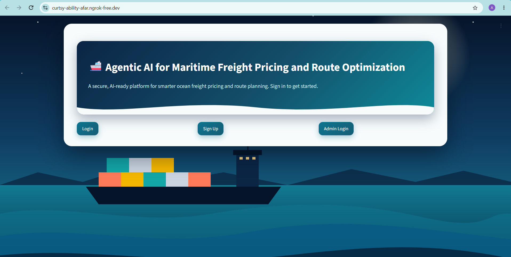
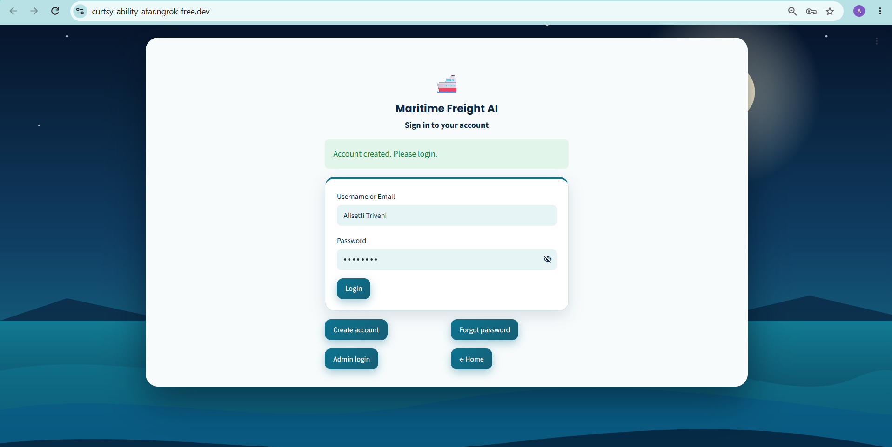
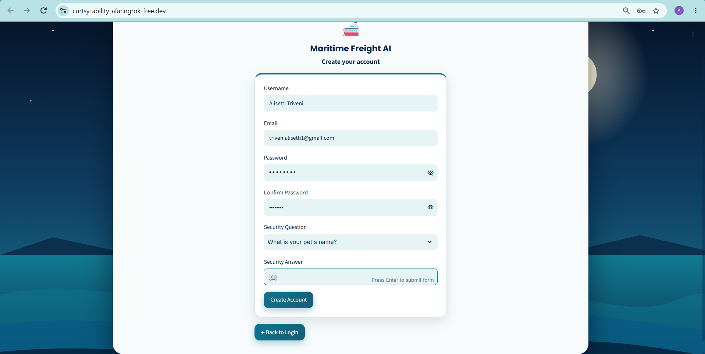
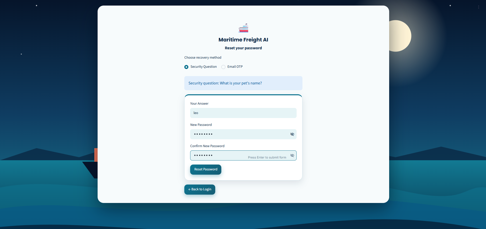
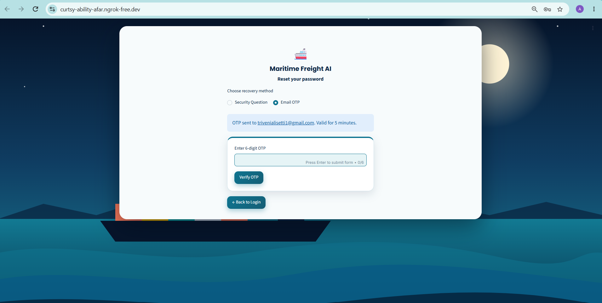
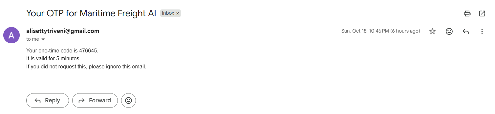
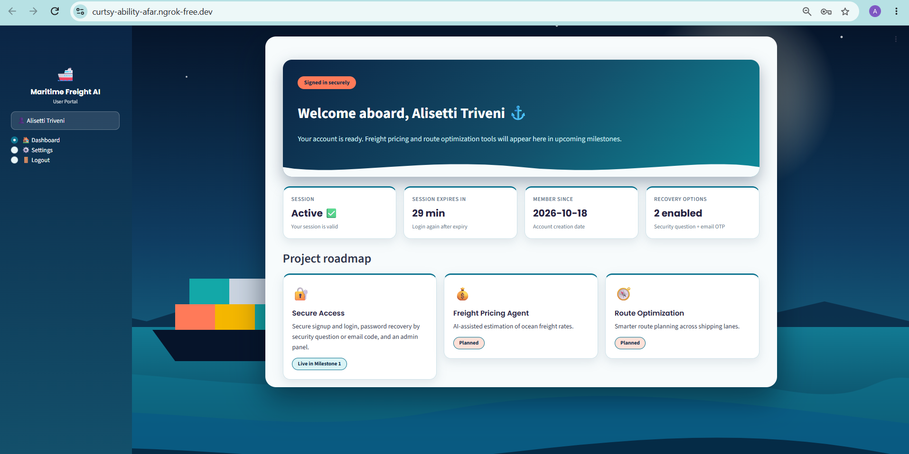

# 🚢 Agentic AI for Maritime Freight Pricing and Route Optimization
### Milestone 1 — User Authentication Module
Infosys Springboard 7.0 · Batch 4

## What is Milestone 1?
The first milestone builds the secure entry point of the project: a web app where users can register, sign in, recover a forgotten password and reach a dashboard, plus an admin area to monitor registered users. The freight-pricing and route-optimization agents will plug into this foundation in later milestones.

## Features
- **Home page** with project title and quick links
- **Signup** – username, email, password, confirm password, security question and answer (all mandatory, unique username)
- **Login** – username or email + password, one generic error message on failure, JWT session token
- **Forgot Password** – two routes: security question, or one-time code (OTP) emailed through Gmail; both enforce the password rule
- **User Dashboard** – welcome message, session info, Settings (change password / security question), Logout
- **Admin Dashboard** – separate admin login, list of all users (never any password data), signups-per-day chart
- **Validation** – mandatory fields, email format (`ab@cd.ef`: 2+ letters in each part), strong password (8+ chars, upper, lower, number, symbol, must match confirm)

## Tech stack
Python · Streamlit · PyJWT · bcrypt · SQLite · SMTP (Gmail App Password) · ngrok · Google Colab

## How to run
1. Open `Milestone1_1(1).ipynb` in Google Colab.
2. Add these **Colab Secrets** (key icon, notebook access ON): `JWT_SECRET`, `NGROK_AUTHTOKEN`, `EMAIL_ADDRESS`, `EMAIL_PASSWORD`, `ADMIN_USERNAME`, `ADMIN_PASSWORD`.
3. *(Optional)* create an `images` folder in the Files panel and upload pictures for the home page.
4. Run cells 1 to 5 in order, then run the last cell and open the printed URL.

## Security notes
- Passwords and security answers are stored as bcrypt hashes, never in plain text.
- All secrets are read from Colab Secrets; none are hard-coded in the notebook.
- Sessions use signed JWTs that expire after 30 minutes; the dashboards check the token on every page load.
- OTPs expire after 5 minutes and allow a limited number of attempts.

## Screenshots
| Page | Screenshot |
|---|---|
| Home |  |
| Login |  |
| Signup |  |
| Forgot Password – Security Question |  |
| Forgot Password – OTP |  |
| OTP Email |  |
| User Dashboard |  |
| Admin Dashboard | ![Admin
