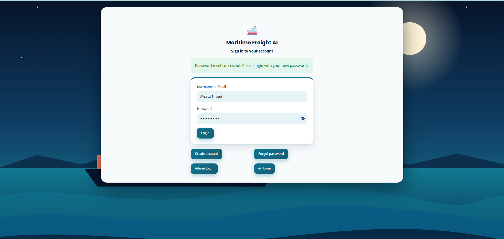
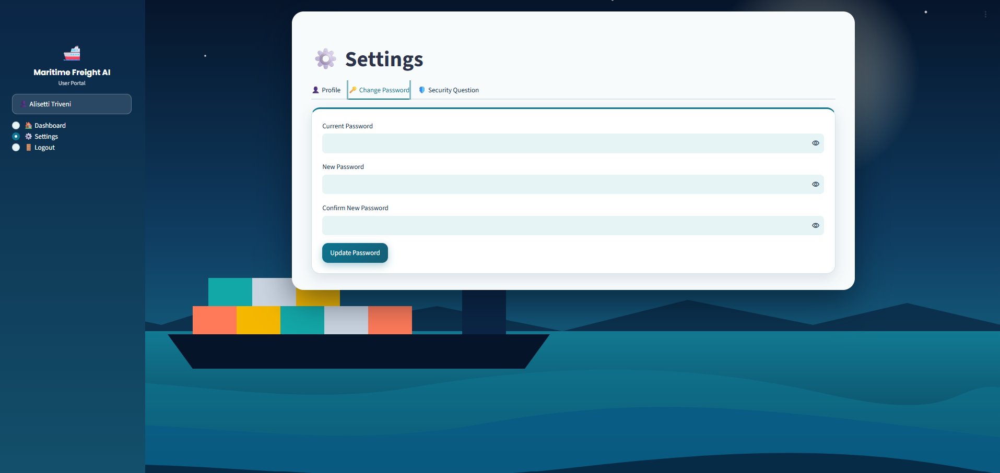
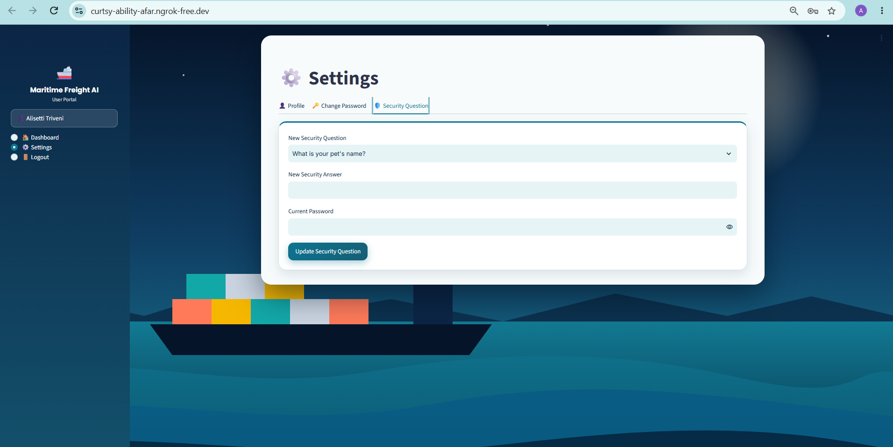
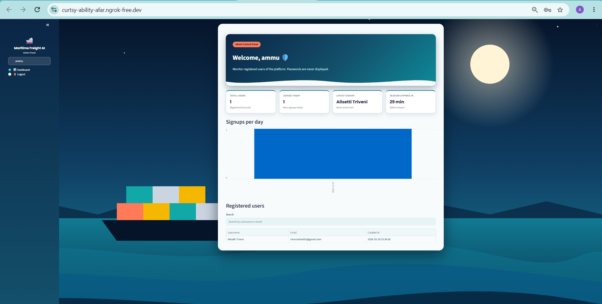

# 🚢 Agentic AI for Maritime Freight Pricing and Route Optimization
### Milestone 1 — User Authentication Module
Infosys Springboard 7.0 · Batch 4

## What is Milestone 1?
The first milestone builds the secure entry point of the project: a web app where users can register, sign in, recover a forgotten password and reach a dashboard, plus an admin area to monitor registered users. The freight-pricing and route-optimization agents will plug into this foundation in later milestones.

## Features
- **Home page** with the project title and quick links to Login, Sign Up and Admin Login
- **Signup** – username, email, password, confirm password, security question and answer (all mandatory, unique username)
- **Login** – username or email + password, one generic error message on failure, JWT session token
- **Forgot Password** – two routes: security question, or one-time code (OTP) emailed through Gmail; both enforce the password rule
- **User Dashboard** – welcome message, session info, Settings (change password / security question), Logout
- **Admin Dashboard** – separate admin login, list of all users (never any password data), signups-per-day chart
- **Validation** – mandatory fields, email format (`ab@cd.ef`: 2+ letters in each part), strong password (8+ chars, upper, lower, number, symbol, must match confirm)

## Tools and Technologies Used
| Tool | What I used it for |
|---|---|
| **Python** | Main programming language for the whole project |
| **Streamlit** | To build the website pages (Login, Signup, Forgot Password, Dashboards) without writing HTML/JavaScript |
| **SQLite** | Small database to store user details (username, email, hashed password, security question) |
| **bcrypt** | To hash passwords and security answers so they are never stored as plain text |
| **PyJWT (JWT)** | To create a secure login token (valid for 30 minutes) and manage user sessions |
| **ngrok (pyngrok)** | To get a public URL for the app running inside Google Colab |
| **Gmail SMTP (App Password)** | To send the OTP email for the Forgot Password feature |
| **Google Colab** | To write, run and host the project; Colab Secrets keep all passwords and tokens safe |
| **pandas** | To prepare the data for the "Signups per day" chart in the Admin Dashboard |
| **HTML and CSS** | For the custom design: colors, cards, sidebar and the harbor background |
| **GitHub** | To store the project files, README and screenshots |

## How the Project Works

### Why ngrok?
The Streamlit app runs inside Google Colab, which does not give a public link by default. **ngrok** creates a secure tunnel from the Colab runtime to a public URL (`https://xxxx.ngrok-free.app`), so the app can be opened in any browser. The ngrok Authtoken is stored in Colab Secrets (`NGROK_AUTHTOKEN`), never inside the code. The URL changes every time the notebook is run, and the site stays online only while the last cell is running.

### How I built it
1. **Setup:** Installed the libraries (Streamlit, pyngrok, PyJWT, bcrypt) and loaded all secrets from Colab Secrets into environment variables.
2. **App code:** Wrote the complete Streamlit app into `app.py` using `%%writefile`. One app contains all pages (Home, Login, Signup, Forgot Password, User Dashboard, Settings, Admin Login, Admin Dashboard), and a simple router shows the right page using `st.session_state`.
3. **Database:** Used SQLite (`auth_users.db`) to store users. Passwords and security answers are saved as bcrypt hashes.
4. **JWT sessions:** After login, a signed JWT (valid for 30 minutes) is created and kept in session state. The dashboards verify the token before showing any content. Admin and user tokens have different roles.
5. **Validation:** Added checks for empty fields, email format (`ab@cd.ef`) and a strong password.
6. **Forgot Password:** Two routes. *Security Question:* enter username, answer the question chosen at signup, set a new password. *Email OTP:* a 6-digit OTP is sent through Gmail SMTP (valid for 5 minutes, limited attempts), then set a new password.
7. **Dashboards:** The user dashboard shows a welcome message, session details and Settings. The admin dashboard has a separate login (credentials from Colab Secrets) and shows total users, signups per day and the user list, without any password data.
8. **Run and share:** The last cell starts Streamlit, opens the ngrok tunnel and prints the public URL.

## How to Run
1. Open `Milestone1_Maritime_Auth_Fixed.ipynb` in Google Colab.
2. Add these **Colab Secrets** (key icon, notebook access ON): `JWT_SECRET`, `NGROK_AUTHTOKEN`, `EMAIL_ADDRESS`, `EMAIL_PASSWORD` (Gmail App Password), `ADMIN_USERNAME`, `ADMIN_PASSWORD`.
3. *(Optional)* create an `images` folder in the Files panel and upload pictures for the home page.
4. Run cells 1 to 5 one by one, then run the last cell. It starts the website and prints the ngrok URL. Keep that cell running while you use the site.

## How to Use the App
1. **Sign up:** Click *Sign Up* and create an account with username, email, strong password and a security question.
2. **Login:** Sign in with username or email and password. A JWT session token is issued and you reach the User Dashboard.
3. **Dashboard and Settings:** See the welcome message and session details. In Settings you can change your password or security question.
4. **Forgot password:** Choose the security question route or the email OTP route, verify yourself, and set a new password.
5. **Admin:** Click *Admin Login* and sign in with the admin credentials from Colab Secrets. The Admin Dashboard shows total users, signups per day and registered users. Passwords are never displayed.
6. **Logout:** Use Logout in the sidebar to end the session.

## Security Notes
- Passwords and security answers are stored as bcrypt hashes, never in plain text.
- All secrets are read from Colab Secrets; none are hard-coded in the notebook.
- Sessions use signed JWTs that expire after 30 minutes; the dashboards check the token on every page load.
- OTPs expire after 5 minutes and allow a limited number of attempts.
- Login shows one generic error, so it never reveals whether the username or the password was wrong.

## Folder Structure
```
Milestone1/
├── README.md
├── Milestone1_Maritime_Auth_Fixed.ipynb
└── screenshots/
    ├── home.png
    ├── login.png
    └── ... (all screenshots)


## Screenshots
| Page | Screenshot |
|---|---|
| Home |  |
| Login |  |
| Signup |  |
| Forgot Password – Security Question |  |
| Forgot Password – OTP |  |
| Password reset successful |  |
| OTP Email |  |
| User Dashboard |  |
| Settings – Change Password |  |
| Settings – Security Question |  |
| Admin Login |  |
| Admin Dashboard |  |
